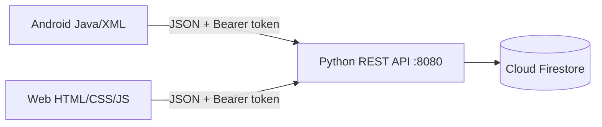

# FoodNow — Android + API + Cloud Firestore + web quản trị

Mã nguồn: [GitHub FoodNow Android](https://github.com/thinh170405/FoodNow-Android). Báo cáo có ảnh Cloud Firestore: [FoodNow_Bao_Cao_Man_Hinh_Firestore_523H0180.docx](reports/FoodNow_Bao_Cao_Man_Hinh_Firestore_523H0180.docx).

## Cấu trúc project

| Thư mục | Nội dung |
|---|---|
| `app/` | Ứng dụng Android cho khách hàng và tài xế |
| `backend/` | REST API Python và trang quản trị trong `backend/web/` |
| `docs/` | Hướng dẫn, kết quả kiểm thử và đề bài gốc |
| `reports/` | Báo cáo Word và ảnh chụp giao diện |
| `img/` | Ảnh mẫu dùng cho kiểm thử và dữ liệu minh họa |
| `gradle/` | Gradle Wrapper và cấu hình build |

Hai thư mục `FoodNow_unrelated_archive_2026-10-29` và `FoodNow_history_archive_2026-10-29` nằm cạnh project, chứa bài tiền điện cùng các bản nháp và log cũ.

Tài liệu cho người mới: [tạo giao diện Android XML](docs/HUONG_DAN_TAO_GIAO_DIEN_ANDROID_XML.md) và [Android Java/XML với FoodNow](docs/HUONG_DAN_ANDROID_JAVA_XML_CO_BAN.md). Cấu hình Firestore của FoodNow được mô tả bên dưới và trong [hướng dẫn thiết lập](docs/SETUP_FIREBASE_MAPS.md). Xem [mục lục tài liệu](docs/README.md) để tìm đề bài, kết quả kiểm thử và báo cáo.

## Đăng nhập tài xế riêng (28/10/2026)

Trên màn hình đăng nhập khách, chọn **Đăng nhập tài xế** để mở form riêng.
Quản trị viên tạo tài khoản tại web → **Khách hàng** → **Tạo tài khoản tài xế**.
Tài khoản `driver` chỉ đăng nhập tại form tài xế, xem các đơn đang giao, xem
chi tiết/điểm giao, chat và chia sẻ vị trí. Tài khoản khách/admin không đăng
nhập được tại form này. Tài xế có nút đổi mật khẩu và đăng xuất.

Hiện tất cả tài xế thấy các đơn ở trạng thái **Đang giao**; chưa có phân công
đơn hoặc tìm tài xế gần nhất. Web quản trị vẫn chuyển trạng thái đơn. Khách
xác nhận đã nhận hàng. Cần khởi động lại backend và cài APK mới sau thay đổi.

## Lưu trữ hiện tại: Cloud Firestore (28/10/2026)

Backend mặc định kết nối Cloud Firestore của project `foodnow-44d00`.
`backend/start.ps1` đọc khóa Firebase Admin từ `GOOGLE_APPLICATION_CREDENTIALS`,
`backend/service-account.json` hoặc `backend/firestore-credentials.path` (file
chứa đường dẫn tới khóa ở ngoài project). Không đưa khóa riêng lên Git.
Android và web vẫn gọi REST API, không truy cập Firestore trực tiếp.

Dữ liệu SQLite cũ đã được sao lưu và sao chép một lần vào Firestore. File
`backend/data/foodnow.db` chỉ là bản cũ; server mặc định không đọc/ghi file
này. `python backend/server.py --db <path>` vẫn dùng SQLite cho kiểm thử riêng.
Không chạy lại script migration trên Firestore đã có dữ liệu.

Backend tải dữ liệu Firestore vào chỉ mục quan hệ trong bộ nhớ khi khởi động,
rồi ghi thay đổi lên Firestore trước khi trả lời request. Chạy **một tiến trình
backend** và khởi động lại nếu sửa dữ liệu trực tiếp trong Firebase Console.
Hiện chưa hỗ trợ nhiều server cùng ghi hoặc client ghi Firestore trực tiếp.

Ứng dụng đặt món Java/XML. Android và web quản trị dùng chung REST API Python và Cloud Firestore. Python 3.11+. Tạo môi trường riêng bằng `python -m venv backend/.venv`, sau đó chạy `backend/.venv/Scripts/python.exe -m pip install -r backend/requirements.txt`.

## Chạy bài

1. Mở PowerShell tại project, chạy `backend/start.ps1`. Script dùng môi trường riêng và tự nhận `backend/service-account.json` nếu có. Giữ server chạy trong buổi demo.
2. Mở **http://localhost:8080**. Tài khoản quản trị lần đầu nằm trong `backend/data/admin-credentials.txt`. Web có chức năng đổi mật khẩu.
3. Mở project bằng Android Studio, chọn máy ảo, Run `app`. Bản debug mặc định kết nối **http://10.0.2.2:8080**.
4. Bấm **Đăng ký** tạo tài khoản khách rồi đăng nhập. Tài khoản cục bộ phiên bản cũ không tự chuyển sang server.
   Trên Android 17, chọn **Cho phép** khi app hỏi quyền mạng nội bộ / thiết bị ở gần để kết nối máy chủ.
5. Chọn nhà hàng → chọn món → giỏ hàng → thanh toán → nhập thông tin giao hàng → xác nhận. Đơn lưu Firestore và xuất hiện trên web.
6. Web xác nhận đơn → đang giao → hoàn thành. App tự lấy trạng thái mới khi mở lại tab **Đơn hàng**. Web tự tải lại đơn mỗi 15 giây.

Máy thật: cùng Wi-Fi với máy tính. Bản debug cho phép **nhấn giữ ảnh món ăn ở đầu màn hình đăng nhập khách** để mở cấu hình server, nhập `http://<IPv4-máy-tính>:8080`, bấm **Kiểm tra** rồi **Lưu**. Xem IPv4 bằng `ipconfig`; IP có thể đổi khi chuyển mạng. Thử mở cùng địa chỉ trên trình duyệt điện thoại trước. Nếu bị chặn, cho phép Python/cổng 8080 qua Windows Firewall cho mạng đang dùng. `10.0.2.2` chỉ dành cho máy ảo; `localhost` trên điện thoại chỉ chính điện thoại.

Nếu máy ảo không truy cập được 10.0.2.2 hoặc dùng điện thoại qua USB, chạy `adb reverse tcp:8080 tcp:8080`, sau đó cấu hình app **http://127.0.0.1:8080**. Chạy lại lệnh reverse sau khi kết nối lại thiết bị. ADB trên máy này: `E:/Android/SDK/platform-tools/adb.exe`.

## Chức năng

- Đăng ký, đăng nhập, đăng xuất, đổi mật khẩu; PBKDF2-SHA256 và salt ngẫu nhiên trên server. Phiên 7 ngày, đổi mật khẩu thu hồi tất cả phiên.
- Hồ sơ tên/điện thoại/địa chỉ đồng bộ giữa thiết bị; email đăng nhập không đổi.
- Nhà hàng/thực đơn từ database, tìm kiếm có/không dấu; tự cập nhật khi mở tab Trang chủ hoặc quay lại từ màn hình khác. Không còn nút tải lại trên giao diện chính. Nút Thử lại chỉ xuất hiện khi kết nối lỗi.
- Giỏ hàng cục bộ theo tài khoản/server/nhà hàng/ID món; tăng/giảm/xóa, tối đa 99 phần/món.
- Đặt hàng với người nhận, ghi chú, phí giao 15.000 VND. Server kiểm tra giá/món còn bán và chống đặt trùng khi gửi lại.
- Lịch sử đơn trên server, giữ giá và tên món tại thời điểm đặt. Khách hủy đơn chờ/đã xác nhận; xác nhận nhận hàng khi đang giao.
- Web admin: thống kê, danh sách khách, thêm/sửa/ẩn nhà hàng và món, chi tiết và trạng thái đơn.

## Kiến trúc



Cloud Firestore gồm users, sessions, restaurants, foods, orders, order_items và các collection bổ sung. Lần đầu tạo 4 nhà hàng/28 món; các lần sau giữ dữ liệu. Chi tiết API/sao lưu: [backend/README.md](backend/README.md).

## Build và kiểm thử

JDK trên máy này: `E:/App/Androi studio/jbr` (JDK 25). SDK lấy từ `local.properties`.

```powershell
$env:JAVA_HOME='E:/App/Androi studio/jbr'
.\gradlew.bat :app:assembleDebug :app:lintDebug :app:testDebugUnitTest
python -m unittest discover -s backend -p test_server.py
```

APK: `app/build/outputs/apk/debug/app-debug.apk`. Lint: `app/build/reports/lint-results-debug.html`.

Kiểm thử tích hợp dùng **database tạm riêng**. Chạy `python backend/run_test_server.py`, giữ cửa sổ mở. Kết nối máy ảo (truy cập server qua 10.0.2.2:8081), rồi chạy `gradlew.bat :app:connectedDebugAndroidTest`. Nếu Gradle thiếu dependency UTP khi offline, build `:app:assembleDebug :app:assembleDebugAndroidTest`, cài hai APK qua `adb install -r`, rồi chạy `adb shell am instrument -w -e class com.example.project1.BackendIntegrationTest com.example.project1.test/androidx.test.runner.AndroidJUnitRunner`.

`BackendIntegrationTest` kiểm tra giao diện đăng nhập/chọn món/đặt hàng, đơn trong API, hủy và đăng nhập lại. `test_server.py` kiểm tra quyền, giá và trạng thái. `node backend/test_web.cjs` (cần Playwright và Edge) kiểm tra admin thêm món, cập nhật đơn, API đồng bộ, bố cục desktop/mobile.

## Phạm vi

### Tải ảnh món ăn từ máy

Web quản trị → **Thực đơn & nhà hàng** → **Thêm món ăn** hoặc **Chỉnh sửa** → **Chọn ảnh từ máy** → xem trước → **Lưu thay đổi**. Hỗ trợ JPG/PNG/WebP tối đa 5 MB, 16 triệu điểm ảnh, tối đa 8192 px mỗi chiều. Server chuyển sang JPEG, chỉnh chiều ảnh theo EXIF và thu nhỏ tối đa 1600 px; metadata ảnh không được giữ. Có thể chọn lại ảnh có sẵn để bỏ lựa chọn tệp mới.

Ảnh lưu trong collection `uploaded_images` của Firestore theo các document nhỏ để không vượt giới hạn kích thước. Bản sao SQLite cũ không chứa ảnh tải lên sau khi chuyển đổi. Mỗi nội dung ảnh có khóa riêng, không ghi đè ảnh cũ. Nếu sửa món thất bại sau upload, ảnh chưa sử dụng vẫn còn trong database và có thể được tái sử dụng khi thử lại; hiện chưa có dọn ảnh tự động. Android cần cài APK mới và mở lại Trang chủ/nhà hàng để nhận ảnh mới; khi mất kết nối dùng ảnh thay thế. Web nhà hàng vẫn dùng bộ ảnh có sẵn.

### Chọn điểm giao hàng trên bản đồ

Ở màn hình Thanh toán, bấm **Chọn điểm giao trên bản đồ**. Tìm địa chỉ kèm quận/thành phố (nếu thiết bị có dịch vụ Geocoder), hoặc kéo/thu phóng bản đồ đến nơi cần giao. Chạm để đặt ghim, kéo ghim để chỉnh rồi bấm **Dùng điểm giao hàng này**. Điền địa chỉ/số nhà/tầng/phòng ở ô địa chỉ như bình thường. Có thể bỏ ghim trước khi đặt; ghim là thông tin bổ sung, không bắt buộc.

Đơn lưu cả địa chỉ chữ và cặp tọa độ. Trong lịch sử app có **Xem điểm giao hàng**; trên web vào **Chi tiết → Mở điểm giao hàng trên bản đồ**. Hủy màn hình chọn không thay đổi ghim cũ. Xoay màn hình giữ điểm đã chọn. Database tự thêm hai cột nullable, không xóa đơn cũ.

Bản đồ dùng Google Maps SDK khi đã cấu hình khóa trong `services.properties`; khi chưa có khóa dùng Leaflet/OpenStreetMap. Nút **Dùng vị trí hiện tại** xin quyền và lấy GPS của điện thoại. Cần Internet để tải nền; tìm địa chỉ phụ thuộc Geocoder. Leaflet có giấy phép tại `app/src/main/assets/map/LEAFLET-LICENSE.txt`; giữ attribution OpenStreetMap và không tải tile hàng loạt/offline.

### Các module bổ sung ngày 15/10/2026

- Đăng nhập Google qua Credential Manager và Firebase Authentication, backend xác minh ID token bằng Firebase Admin.
- Thông báo trạng thái đơn/chat bằng FCM; app đang mở cũng kiểm tra sự kiện định kỳ. Cần cấp quyền thông báo.
- Chụp ảnh đại diện bằng ứng dụng camera, chuẩn hóa ảnh và lưu trên server; hiệu ứng chuyển màn hình.
- Chat theo đơn giữa khách và web quản trị, lưu Firestore và cập nhật định kỳ.
- Chia sẻ GPS khi đơn đang giao: tài khoản tài xế dùng màn hình giao hàng trên điện thoại; khách xem vị trí và thời gian cập nhật. Chỉ chia sẻ khi màn hình mở; chưa có phân công tài xế theo đơn.

Hướng dẫn cấu hình và thử từng chức năng: [SETUP_FIREBASE_MAPS.md](docs/SETUP_FIREBASE_MAPS.md). File Firebase Android đã có OAuth; vẫn cần Firebase Admin trên server và Maps API key để chạy đầy đủ. Chưa xác nhận các luồng cloud/GPS/camera mới trên điện thoại thật. Google đáp ứng tích hợp tài khoản mạng xã hội; Facebook chưa triển khai.

Hệ thống local/LAN phục vụ bài môn di động, chưa triển khai Internet. Ví/chuyển khoản **chỉ mô phỏng**, chưa thu tiền thật; chưa gửi email khôi phục mật khẩu. App cần server để đăng nhập/xem thực đơn/đặt hàng.

Bản debug cho phép HTTP local. Release cần HTTPS; máy chủ Python đi kèm phục vụ demo, cần cấu hình triển khai phù hợp trước khi sử dụng công khai.

## Khôi phục bản server — 22/10/2026

Đã chuyển Android trở lại REST API, dùng remote_session và hồ sơ theo server như trước. Database/backend/web cũ được giữ nguyên, không nhập hay xóa tài khoản/đơn hàng của bản cục bộ. Khôi phục Google/Firebase, FCM, chat đơn hàng, ảnh tải từ web và màn hình quản trị chia sẻ GPS. Các chức năng cloud vẫn cần cấu hình dịch vụ thật; không coi build thành công là xác nhận Maps/Firebase đã hoạt động.

Bản cục bộ lịch sử đã chuyển sang thư mục FoodNow_history_archive_2026-10-29/backend/local-version-backup ở cạnh project để tham khảo, không nằm trong source set Android. Chạy backend/start.ps1 và cấu hình IP server như hướng dẫn trên. Giao hàng dùng tài khoản tài xế riêng; chưa có phân công tài xế theo đơn.

## Lịch sử: đăng nhập giao hàng — 22/10/2026

Màn hình khách có nút **Đăng nhập người giao hàng** mở form riêng (`activity_delivery_signin.xml`). Phiên bản hiện tại nhập email/mật khẩu tài khoản tài xế được quản trị viên cấp để vào thẳng DeliveryActivity, xem đơn đang giao, chia sẻ GPS và chat. Có đăng xuất; mở lại app giữ đúng giao diện giao hàng khi phiên còn lưu.

API POST /api/auth/delivery-login kiểm tra mật khẩu và quyền driver trước khi tạo phiên. Tài khoản customer/admin bị trả 403. Không tự đăng ký tài khoản tài xế trong app; admin cấp tài khoản trên web. Chưa có phân công đơn riêng.

Cần khởi động lại backend sau khi cập nhật để có endpoint mới.

### Đăng nhập mạng xã hội (minh họa)

Google và Facebook trên màn hình đăng nhập hiện chỉ là hai nút minh họa. Bấm nút hiện thông báo phát triển sau, không gọi Google/Firebase hoặc tạo phiên. Đăng nhập email/mật khẩu vẫn hoạt động. Mã tích hợp cloud cũ được giữ để có thể phát triển tiếp.


